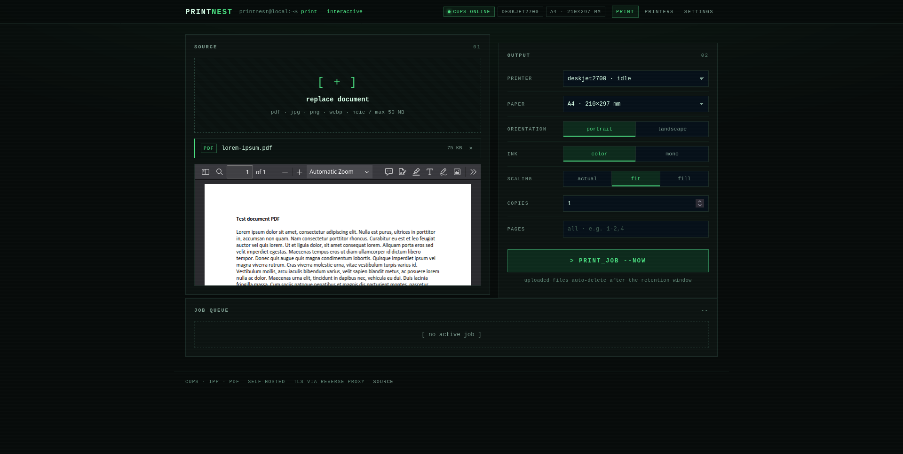
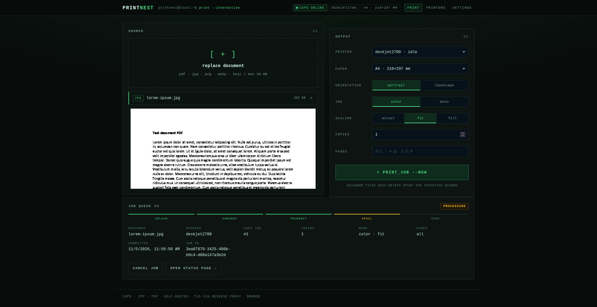
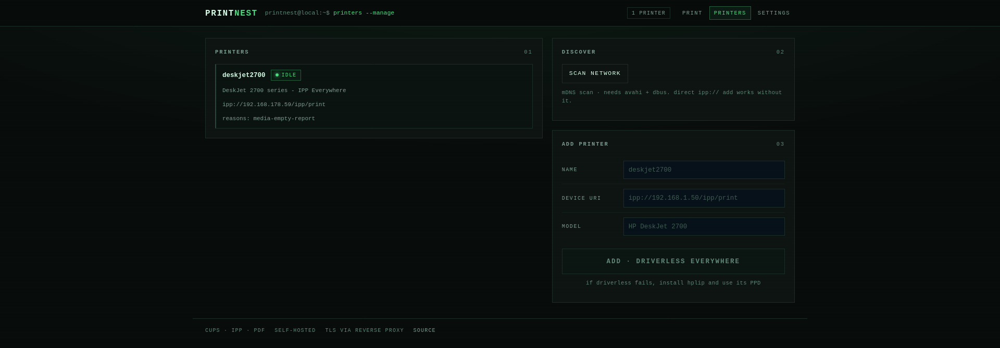
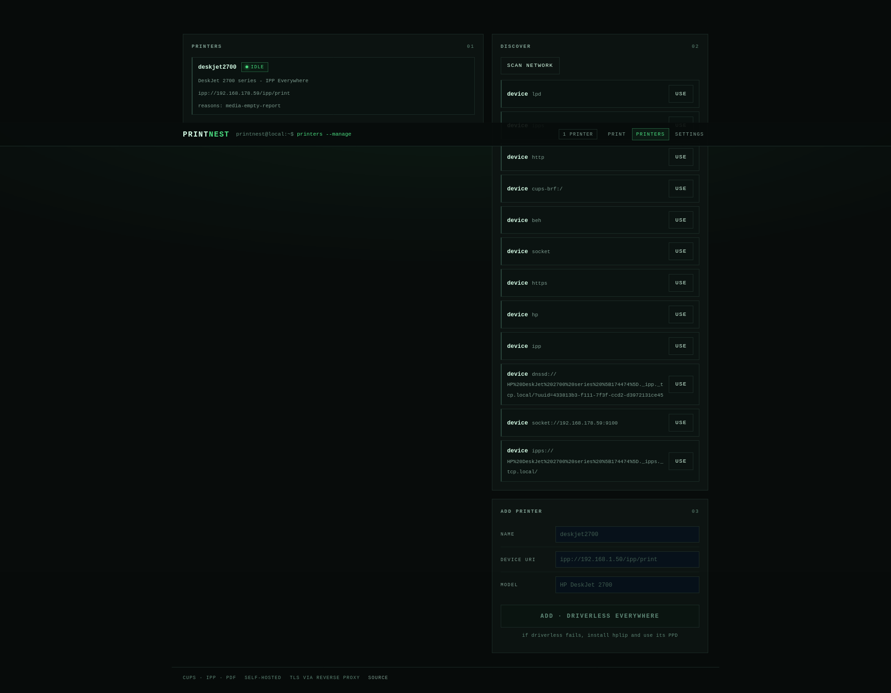
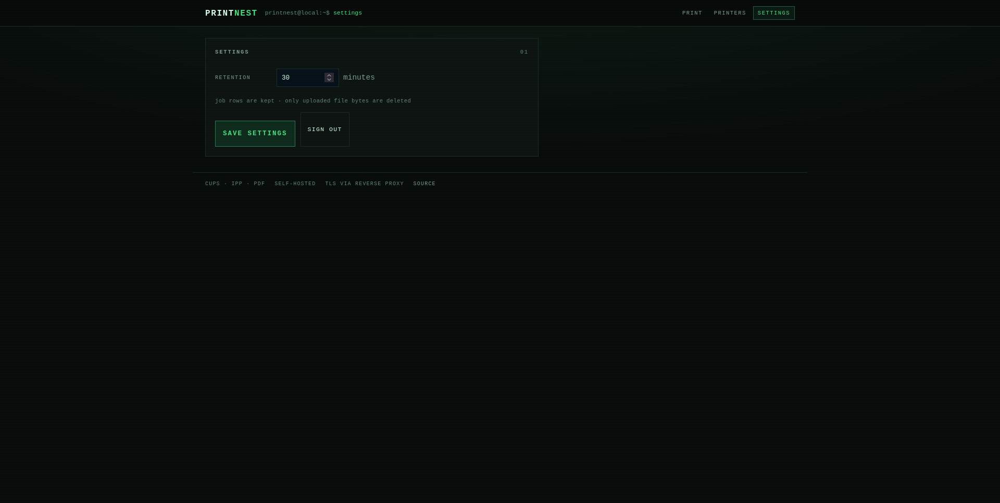

# PrintNest - Simple, private, self-hosted printing.

Open-source print portal for home networks. Phone/PC uploads a file over
HTTPS, the Go backend normalizes it to PDF and prints via CUPS/IPP to a
network printer (first target: HP DeskJet 2700, A4).

Flow: Choose / Share file -> Preview -> Configure -> Print.

## Screenshots

| | |
|---|---|
|  |  |
|  |  |
|  |  |

## Install (native LXC, no Docker)

Works in a Debian/Ubuntu or Alpine LXC on Proxmox, amd64 or arm64. Nothing is
compiled on the container and no git clone is needed. Each release contains a
static binary, the built web UI, the installers, and the config templates.

Run as root inside the container. Both options below need curl first:

```sh
apt-get install -y curl ca-certificates      # Alpine: apk add curl ca-certificates
```

Option A, one command (downloads the release for this architecture and verifies it):

```sh
# Debian/Ubuntu
curl -fsSL https://github.com/shut-sh/printnest/releases/download/v0.2.2/install.sh | RELEASE_TAG=v0.2.2 bash

# Alpine
curl -fsSL https://github.com/shut-sh/printnest/releases/download/v0.2.2/install-alpine.sh | RELEASE_TAG=v0.2.2 sh
```

Option B, download and verify the tarball yourself, then install from it:

```sh
VERSION=0.2.2
ARCH=$(uname -m | sed -e 's/x86_64/amd64/' -e 's/aarch64/arm64/')
BASE=https://github.com/shut-sh/printnest/releases/download/v$VERSION
curl -fsSLO "$BASE/printnest-$VERSION-linux-$ARCH.tar.gz"
curl -fsSLO "$BASE/printnest-$VERSION-linux-$ARCH.tar.gz.sha256"
sha256sum -c "printnest-$VERSION-linux-$ARCH.tar.gz.sha256"
tar xzf "printnest-$VERSION-linux-$ARCH.tar.gz"
./printnest/deploy/lxc/install.sh            # Alpine: sh ./printnest/deploy/lxc/install-alpine.sh
```

The installer also adds `cups-filters`, so CUPS converts PDFs for printers that do
not accept PDF directly (most inkjets, including the DeskJet 2700).

Both options install the same things: `/usr/local/bin/printnest`, the web UI and
templates under `/opt/printnest`, the config at `/var/lib/printnest/config.env`, and a
`printnest` service (systemd, or OpenRC on Alpine). The service is enabled but
stays stopped until you set the admin password:

```sh
vi /var/lib/printnest/config.env     # PRINTNEST_PASSWORD is read on first start only
systemctl start printnest            # Alpine: rc-service printnest start
```

Logs: `journalctl -u printnest` on Debian/Ubuntu, `/var/log/printnest.log` on Alpine.

Add the DeskJet (driverless first, hplip fallback). The installer adds `root` (and the
user who ran `sudo`, if any) to the `lpadmin` group. CUPS requires that membership for
admin commands, so without it `lpadmin` returns `Forbidden`:

```sh
lpadmin -p deskjet2700 -E -v ipp://<printer-ip>/ipp/print -m everywhere \
  -o printer-error-policy=retry-job
# if that fails: hp-setup -i  (hplip), then retry with the hplip PPD
lpstat -p -d
```

Point your existing nginx HTTPS vhost at `http://127.0.0.1:8080`, using
`/opt/printnest/deploy/lxc/nginx-snippet.conf` as the template. PWA install and the
Android Share Target require HTTPS, which your nginx provides; the app itself serves plain HTTP.

mDNS discovery (network scan) on Alpine needs `avahi` and `dbus` running; a direct
`ipp://` add works without them.

To upgrade, run the installer again with the new release. Config and uploads are kept,
and a running service is restarted.

Installer options (environment variables, all optional):

| Variable | Effect |
|---|---|
| `RELEASE_TAG` | Release to download when running standalone (default: latest) |
| `BUNDLE_FILE` | Install from a local tarball instead of downloading |
| `BUNDLE_URL`, `BUNDLE_SHA256` | Download from any URL and verify against the given sha256 hex digest |
| `INSTALL_HPLIP=0` | Skip hplip (driverless `everywhere` only, smaller) |
| `APP_DIR`, `DATA_DIR`, `APP_USER` | Install locations and service user |
| `IPP_TIMEOUT_SECONDS` | Seconds before a printer is reported unresponsive (default 25) |

The installer also writes a bounded retry policy into `/etc/cups/cupsd.conf`
(`JobRetryLimit 3`, `JobRetryInterval 30`, between `# BEGIN printnest` markers) and
keeps the previous file as `cupsd.conf.printnest.bak`. Queues must use the
`retry-job` error policy for it to apply; the app creates queues that way, and the
manual `lpadmin` command above sets it explicitly.

If a printer is powered on but stops answering IPP, the app now fails the request
after `IPP_TIMEOUT_SECONDS` (default 25) with HTTP 504 and "did not respond · check
the printer; if it is on but unresponsive, power cycle it and retry" instead of
hanging. A job that shows no progress for 5 minutes while processing (15 minutes
while queued) gets the same hint, including any CUPS printer-state reason such as
`connecting-to-device`. Retries do not help in that state; only a printer power
cycle does.

When the installer runs from an extracted bundle (Option B), it does not download the
bundle again. Package installation still fetches from the distro repositories.

## Using it

1. Open the site, sign in with the admin password.
2. Upload / share / drag-drop a PDF, JPG, PNG, WEBP, or HEIC (max 50 MB).
3. Preview, pick printer, A4, portrait/landscape, color/BW, actual/fit/fill,
   copies, page range (e.g. `1-2`).
4. Print, watch job status, cancel if needed.
5. Uploaded file bytes auto-delete after `file_retention_minutes`
   (default 30, Admin UI); job rows are kept.

Admin pages: `/admin/printers` (scan network via CUPS-Get-Devices,
add with driverless `everywhere`), `/admin/settings` (retention).

## Phone / PWA

Install on Android (Chrome), over HTTPS with a trusted certificate:

1. Open the site and sign in.
2. Chrome menu > "Install app" (or "Add to Home screen").
3. Open the installed app once so the service worker takes control.
4. In Photos, Files, or another app: Share > PrintNest. The shared file lands
   in the print preview with the printer options ready.

The share target accepts PDF, JPEG, PNG, WebP, HEIC, and HEIF, and uses the first
file when several are shared. Plain HTTP on a LAN IP will not offer install or
share, so use the nginx HTTPS vhost.

iOS: Safari > Share > "Add to Home Screen" works, but iOS has no Web Share
Target, so PrintNest never appears in the iOS share sheet. Use "Choose file",
which accepts HEIC.

Desktop Chrome/Edge also offer an install button in the address bar.

## Dev

```sh
cd frontend && npm ci && npm run build && cd ..
cd backend && go test ./... && go vet ./...
PRINTNEST_PASSWORD=devpass DATA_DIR=/tmp/pn-data FRONTEND_DIR=$(pwd)/../frontend/dist go run .
```

API: `POST /api/login`, `GET /api/printers`, `POST /api/printers/discover`,
`POST /api/printers/add`, `GET /api/printers/{name}/caps`,
`POST /api/jobs` (multipart `file`), `POST /api/jobs/{id}/print`,
`GET /api/jobs/{id}`, `POST /api/jobs/{id}/cancel`, `GET/PUT /api/settings`.

## Release (manual)

The GitHub Actions release workflow is disabled, so releases are cut by hand.
`deploy/build-bundle.sh` writes one static bundle per architecture plus the two
installers into `dist/`:

```sh
git tag -a v0.2.2 -m "PrintNest v0.2.2" && git push origin v0.2.2
bash deploy/build-bundle.sh --version 0.2.2
gh release create v0.2.2 --title "PrintNest v0.2.2" --generate-notes dist/*
```

## E2E prove-out (DeskJet 2700)

Discover, add `everywhere`, then physically print: A4 color, mono,
scaling none/fit/fill, copies=2, page-ranges=1-2. Cancel a queued job.
Confirm file bytes vanish after retention while rows persist, and that
`printer-state-reasons` surface on failure. Missing `heif-convert` yields
HTTP 415; >50 MB yields 413; bad attrs yield 400 with the supported list.

## Non-goals (V1)

No Docker image, no Caddy default, no multi-user, no file history,
no server thumbnails, no iOS Share Extension, no duplex/staple UI,
no auto/auto-fit scaling, no raw image passthrough (images always go
to CUPS as PDF).

MIT - see LICENSE.
